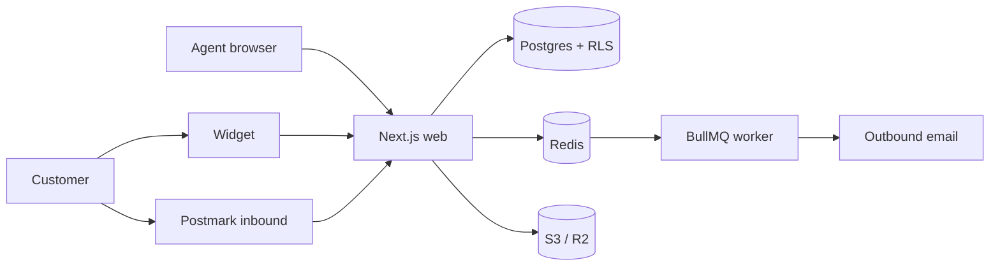

# Relay

Multi-tenant shared inbox for support teams — keyboard-first triage, email + widget channels, SLA/automations, Stripe billing, and Postgres RLS isolation.

**Live demo:** [/demo](/demo) (read-only viewer) · **Loom:** _add recording URL_ · **Docs:** [`docs/ARCHITECTURE.md`](docs/ARCHITECTURE.md) (local)


## Screenshots

Add inbox, command palette, analytics, dark mode, and widget captures under `public/images/` when recording the walkthrough.

## Problem and audience

Support tools either overshare data between customers or bury agents in mouse-driven UIs. Relay is for B2B product teams that need one workspace per customer org, fast keyboard triage, and credible email/billing primitives they can demo to clients.

## Features

- Shared inbox with filters, bulk actions, and SSE live updates
- TipTap composer, canned replies, attachments (S3/MinIO)
- Inbound/outbound email with Message-ID threading
- SLA timers, automations, analytics CSV export
- Stripe Free / Pro / Business limits
- Customer portal + embeddable widget
- Read-only demo login for portfolio walkthroughs

## Architecture



Source diagrams: [`diagrams/system.mmd`](diagrams/system.mmd), [`diagrams/er.mmd`](diagrams/er.mmd).

**Stack:** Next.js App Router, Auth.js, Prisma 8, Postgres RLS, Redis/BullMQ, TipTap, Stripe, Postmark/SMTP, S3, Playwright/Vitest.

## Key decisions

| Decision | Trade-off |
|---|---|
| Postgres RLS per workspace | Strong isolation; requires careful `systemDb` vs tenant DB usage |
| SSE + Redis fan-out | Simple horizontal scale; needs sticky-enough long-lived connections (avoid serverless web) |
| Idempotent Stripe/Postmark webhooks | Safe retries; more bookkeeping |
| Email threading via Message-ID / References | Works with real mail clients; edge cases still exist |

## Local setup (< 10 minutes)

```bash
pnpm install
cp .env.example .env.local   # fill Neon/local Postgres + secrets
docker compose up -d redis mailpit minio
# apply schema / RLS SQL for your environment, then:
pnpm db:seed
pnpm dev                     # web
pnpm dev:worker              # jobs (separate terminal)
```

Open http://localhost:3000 — use the seeded credentials below (or `/demo` for read-only).

Health: `GET /api/health` · Ready: `GET /api/ready`

### Seeded demo credentials

| Role | Email | Password | Notes |
|---|---|---|---|
| Owner | `demo@relay.local` | `password123` | Full access to workspace `demo` |
| Agent | `sam@relay.local` | `password123` | Agent |
| Agent | `riley@relay.local` | `password123` | Agent |
| Agent | `jordan@relay.local` | `password123` | Agent |
| Read-only viewer | `viewer@relay.local` | `password123` | Or open `/demo` |
| Sample customers | `customer1@example.com` … `customer30@example.com` | — | Ticket requesters only |

Workspace slug: **`demo`** · Plan after seed: **PRO**

Seed creates ~100 demo tickets across 45 days, plus **email showcase** threads (multi-message EMAIL tickets with `Message-ID` / delivery status), canned replies, sample automations, and Settings → Email inbound rows (including one failed row for Replay). Reset demo tickets: `pnpm db:reset-demo && pnpm db:seed`

### Email locally (no Postmark required)

```bash
docker compose up -d redis mailpit minio
pnpm dev          # web
pnpm dev:worker   # processes inbound + outbound jobs
pnpm dev:inbound new-thread   # fakes Postmark → creates a ticket for demo@MAIL_DOMAIN
```

Outbound replies land in Mailpit: http://localhost:8025  

Production Postmark is optional — leave `POSTMARK_*` empty in `.env.example` until you deploy; then set the server token, inbound Basic auth, `MAIL_DOMAIN`, and point Postmark inbound at `https://your-host/api/webhooks/postmark/inbound`.

## Testing and CI

```bash
pnpm typecheck
pnpm lint
pnpm test
pnpm test:e2e
bash scripts/check-secrets.sh
```

GitHub Actions runs install → secret scan → typecheck → lint → tests → build on every PR; e2e/deploy hooks are stubbed for `main`.

## Deploy

- `Dockerfile` (web, `output: "standalone"`) + `Dockerfile.worker`
- `fly.toml` / `fly.worker.toml` — run `prisma migrate deploy` as a **release command**, not at container boot
- Set all vars from `.env.example`; point Stripe/Postmark webhooks at production URLs

## Roadmap

Public REST API + webhooks, knowledge base, CSAT, business-hours SLAs, custom email domains, 2FA.

## License

MIT — see [LICENSE](LICENSE).
