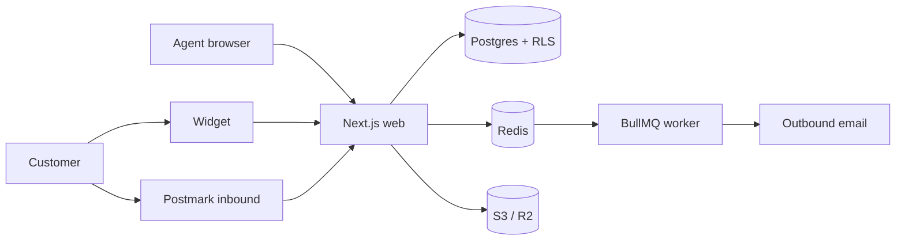

# Relay

Multi-tenant shared inbox for support teams — keyboard-first triage, email + widget channels, SLA/automations, Stripe billing, and Postgres RLS isolation.

| | |
|---|---|
| **Stack** | Next.js App Router · Auth.js · Prisma 8 · Postgres RLS · Redis/BullMQ · TipTap · Stripe · Postmark · S3 |
| **Demo** | `/demo` (read-only) · seed logins below |
| **Deploy** | Web → Vercel · Worker → Fly (or any always-on Node host) |

## Why Relay

Support tools either overshare data between customers or bury agents in mouse-driven UIs. Relay is built for B2B product teams that need **one workspace per customer org**, fast keyboard triage, and email/billing primitives that are credible in a portfolio or client demo.

## Features

- Shared inbox with filters, bulk actions, and SSE live updates
- TipTap composer, canned replies, attachments (S3 / MinIO / R2)
- Inbound / outbound email with Message-ID threading (Postmark in prod, Mailpit locally)
- SLA timers, automations, analytics CSV export
- Stripe Free / Pro / Business plan limits
- Customer portal + embeddable chat widget
- Seeded demo workspace + read-only `/demo` viewer for walkthroughs

## Architecture



Source diagrams: [`diagrams/system.mmd`](diagrams/system.mmd), [`diagrams/er.mmd`](diagrams/er.mmd).

| Decision | Trade-off |
|---|---|
| Postgres RLS per workspace | Strong isolation; careful `systemDb` vs tenant DB usage |
| SSE + Redis fan-out | Simple live inbox; on Vercel, streams reconnect when `maxDuration` ends |
| Idempotent Stripe / Postmark webhooks | Safe retries; more bookkeeping |
| Separate BullMQ worker | Reliable email/SLA jobs; not runnable inside Vercel Functions |

## Local setup

```bash
pnpm install
cp .env.example .env.local   # fill Neon/Postgres + secrets
docker compose up -d redis mailpit minio
# apply schema / RLS for your environment, then:
pnpm db:seed
pnpm dev                     # web → http://localhost:3000
pnpm dev:worker              # jobs (separate terminal)
```

Health: `GET /api/health` · Ready: `GET /api/ready`

### Seeded demo credentials

| Role | Email | Password | Notes |
|---|---|---|---|
| Owner | `demo@relay.local` | `password123` | Full access to workspace `demo` |
| Agent | `sam@relay.local` | `password123` | Agent |
| Agent | `riley@relay.local` | `password123` | Agent |
| Agent | `jordan@relay.local` | `password123` | Agent |
| Read-only viewer | `viewer@relay.local` | `password123` | Or open `/demo` |
| Sample customers | `customer1@example.com` … `customer30@example.com` | — | Ticket requesters only |

Workspace slug: **`demo`** · Plan after seed: **PRO**

Seed creates ~100 tickets across 45 days, plus email showcase threads, canned replies, sample automations, and Settings → Email inbound rows (including one failed row for Replay).

```bash
pnpm db:reset-demo && pnpm db:seed
```

### Email locally

No Postmark account required for demos:

```bash
pnpm dev:inbound new-thread   # fakes Postmark → ticket for the demo inbound address
```

Outbound replies appear in Mailpit: http://localhost:8025

## Deploy

Relay is **two processes**: the Next.js web app and a long-running BullMQ worker.

| Piece | Recommended host | Role |
|---|---|---|
| Web | **Vercel** | UI, API routes, Postmark/Stripe webhooks, SSE |
| Worker | **Fly.io** (`fly.worker.toml`) or any always-on Node host | Inbound/outbound email, SLA scan, automations, cleanup |
| Postgres | Neon (or any Postgres) | App data + RLS |
| Redis | Upstash / Redis Cloud / Fly Redis | BullMQ + realtime fan-out |
| Objects | Cloudflare R2 / S3 / MinIO | Attachments |

### 1. Web on Vercel

1. Import the GitHub repo in [Vercel](https://vercel.com/new).
2. Framework preset: **Next.js** (see [`vercel.json`](vercel.json)).
3. Set **Root Directory** to the repo root; install/build use `pnpm` (`packageManager` is pinned).
4. Add environment variables (copy from [`.env.example`](.env.example)). Minimum for a working demo:

| Variable | Notes |
|---|---|
| `APP_URL` | `https://your-app.vercel.app` (no trailing slash) |
| `AUTH_SECRET` | ≥ 32 random chars |
| `DATABASE_URL` | App role (RLS applies); prefer Neon **direct** host, not `-pooler` |
| `DATABASE_URL_SYSTEM` | System role (bypass RLS for admin paths) |
| `REDIS_URL` | Production Redis (not `localhost`) |
| `MAIL_DOMAIN` / `MAIL_FROM_NAME` | Outbound identity domain / display name |
| `MAIL_FROM_EMAIL` | Verified Postmark Sender Signature (required for outbound) |
| `POSTMARK_SERVER_TOKEN` | Server API token |
| `POSTMARK_INBOUND_USER` / `POSTMARK_INBOUND_PASS` | Basic auth for inbound webhook |
| `S3_*` | R2/S3 endpoint, bucket, keys |
| `STRIPE_*` | Optional until you demo billing |

5. Deploy. `output: "standalone"` is **disabled on Vercel** automatically (`VERCEL=1`) so Docker/Fly images keep standalone builds.
6. Point webhooks at the deployment:

```text
Postmark inbound → POST https://YOUR_APP/api/webhooks/postmark/inbound
                 (Basic auth = POSTMARK_INBOUND_USER:POSTMARK_INBOUND_PASS)

Stripe           → POST https://YOUR_APP/api/webhooks/stripe
```

SSE live updates use `maxDuration = 300` on the events route (Hobby plan ceiling). Clients should reconnect after the stream ends.

### 2. Worker (required for email / SLA / automations)

Vercel does not run the BullMQ worker. Deploy it separately (Fly example already in-repo):

```bash
# set the same secrets as the web app (REDIS_URL, DATABASE_*, POSTMARK_*, S3_*, …)
fly apps create relay-helpdesk-worker   # once
fly deploy -c fly.worker.toml
```

Or run `pnpm start:worker` on any always-on Node 22 host with the same env.

### 3. Fly web (optional alternative)

[`Dockerfile`](Dockerfile) + [`fly.toml`](fly.toml) remain supported if you prefer containers for both web and worker. Run `pnpm db:deploy` as a **release command**, not at container boot.

## Testing

```bash
pnpm typecheck
pnpm lint
pnpm test
pnpm test:e2e
bash scripts/check-secrets.sh
```

GitHub Actions: install → secret scan → typecheck → lint → tests → build on every PR.

## Roadmap

Public REST API + webhooks, knowledge base, CSAT, business-hours SLAs, custom email domains, 2FA.

## License

MIT — see [LICENSE](LICENSE).
